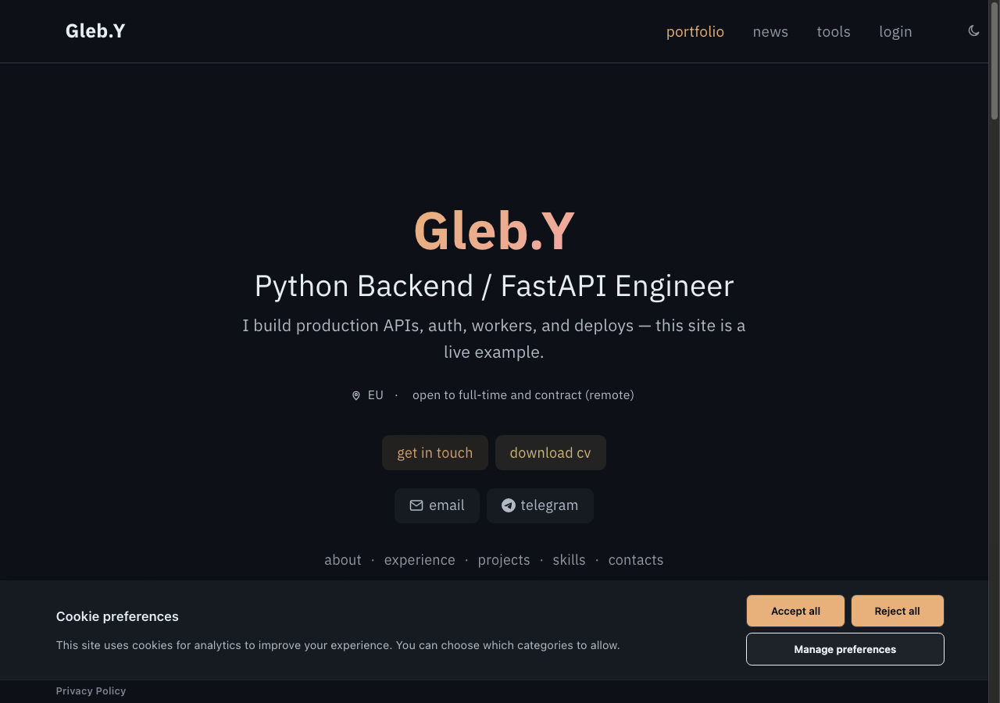
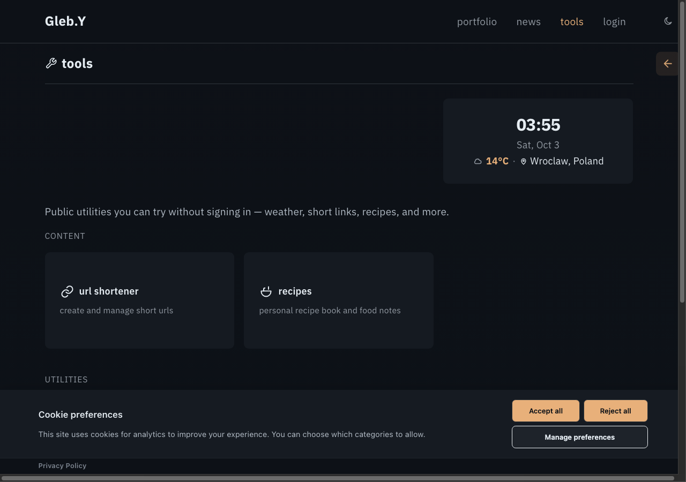
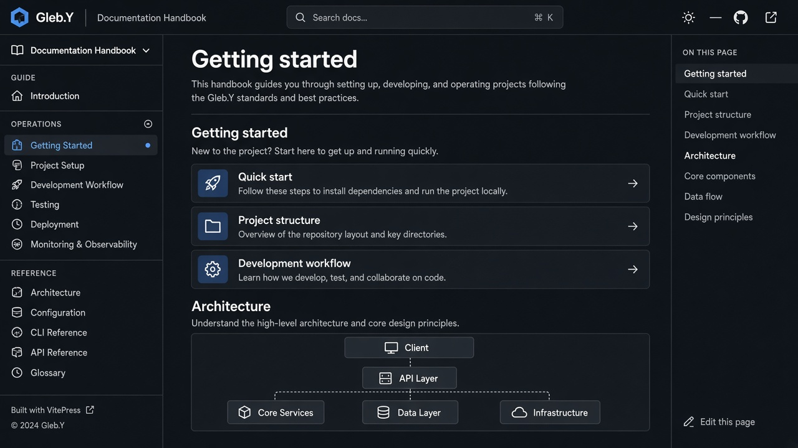

# Gleb.Y — Developer Portfolio & Personal Platform

[](https://github.com/GlebLOrange/personal-glorng/actions/workflows/ci.yml)
[](https://github.com/GlebLOrange/personal-glorng/actions/workflows/security.yml)
[](LICENSE)

Minimal, monospace-styled developer portfolio built with FastAPI + Vue 3 + MongoDB + Redis, fully containerized with Docker. The same domain services power the public site, admin panel, Telegram todobot, and background workers.

**Live handbook:** [gleblorange.github.io/personal-glorng](https://gleblorange.github.io/personal-glorng/)  
**Source:** [github.com/GlebLOrange/personal-glorng](https://github.com/GlebLOrange/personal-glorng)

> The published site above is the VitePress architecture handbook (GitHub Pages). The full Vue + FastAPI app runs via `make prod` on a VPS — set `BASE_URL` / `VITE_PUBLIC_ORIGIN` to that HTTPS origin (OG tags + sitemap). See [Deployment](docs/operations/deployment.md).

## Quick start

First-time setup (`.env`, lite stack, seed): [Getting started](docs/guide/getting-started.md).

```bash
make docs-dev   # local handbook → http://localhost:5173
```

## Screenshots

| Portfolio | Tools | Handbook |
|-----------|-------|----------|
|  |  |  |

## Documentation

| Resource | Link |
|----------|------|
| **First-time setup** | [Getting started](docs/guide/getting-started.md) |
| **Handbook (published)** | [gleblorange.github.io/personal-glorng](https://gleblorange.github.io/personal-glorng/) |
| **Handbook (local)** | `make docs-dev` → [http://localhost:5173](http://localhost:5173) |
| **Handbook (source)** | [docs/index.md](docs/index.md) |
| **Dev modes / make targets** | [Development](docs/guide/development.md) |
| **API / OpenAPI** | [docs/reference/api-tools.md](docs/reference/api-tools.md) |
| **ADRs** | [docs/adr/](docs/adr/) |
| **Cursor / agents** | [AGENTS.md](AGENTS.md), [CODING_STANDARDS.md](CODING_STANDARDS.md) |

Topics: [architecture](docs/guide/architecture.md), [deployment](docs/operations/deployment.md), [API reference](docs/reference/api-tools.md), [configuration](docs/reference/configuration.md), [security](docs/reference/security.md).

After API or platform-registry changes, refresh generated docs: `make docs-generate`.

## Tech stack

- **Backend**: FastAPI, Motor (MongoDB), SQLAlchemy (optional Postgres), Celery, RabbitMQ, Redis
- **Frontend**: Vue 3, Vite, TypeScript, Tailwind CSS, Pinia
- **Proxy**: Nginx
- **Tooling**: uv, Ruff, pytest, ESLint, Vitest, Playwright, Docker Compose

## Project structure

```
server/    FastAPI backend (:8000)
client/    Vue 3 frontend (:3000)
nginx/     Reverse proxy (:80)
docs/      VitePress handbook
```

## License

MIT — see [LICENSE](LICENSE).
