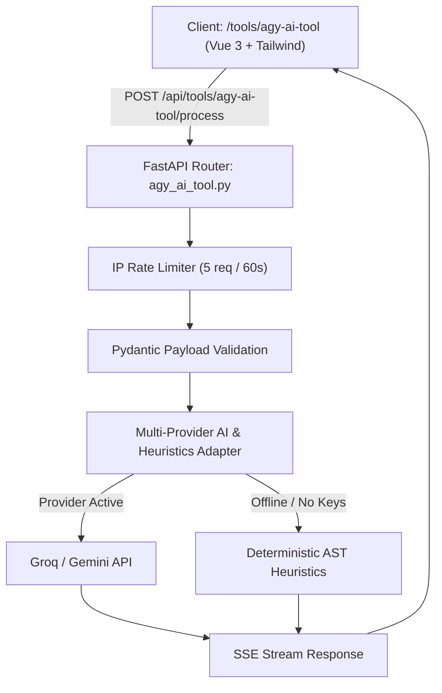

# Spec: `agy-ai-tool` — AI Developer Workbench & Query Lab

## Objective

Provide a lightweight, public, monospace-styled developer workbench that converts, explains, and verifies complex developer patterns (SQL-to-MongoDB aggregations, cURL-to-SDK code, and Regex/Cron expressions) with AI intelligence and deterministic local fallbacks.

## Motivation & Architecture Fit

The portfolio platform currently provides utilities (`calculator`, `qr-generator`, `password-generator`, `data-extract`) and a locked superuser chat (`ai-chat`). However, developer portfolios shine when visiting engineers and recruiters can interact with domain-relevant tools directly connected to the platform's core architecture (MongoDB Motor, FastAPI, and TypeScript).

`agy-ai-tool` directly links to the project's stack:
1. **SQL → MongoDB Aggregation Pipeline**: Translates ANSI SQL `SELECT / JOIN / GROUP BY` into MongoDB aggregation pipelines and Python Motor code.
2. **cURL → Python / TypeScript Fetch**: Converts cURL commands into idiomatic Python `httpx` or TypeScript `fetch` snippets with typed payloads and header parsing.
3. **Regex & Cron Visualizer**: Deconstructs regular expressions and cron syntax into step-by-step human explanations with generated edge-case verification tests.



---

## Tool Capabilities & Modes

| Mode | Input | Output | Offline Fallback |
|------|-------|--------|------------------|
| `sql_to_mongo` | ANSI SQL Query | MongoDB Aggregation Pipeline (`$match`, `$group`, `$lookup`, `$project`) + Motor Python snippet | Basic `SELECT...FROM...WHERE` AST converter |
| `curl_to_sdk` | cURL command string | Python `httpx` / TypeScript `fetch` client code with headers and auth | Regex/header parsing and dictionary conversion |
| `regex_cron_visualizer` | Regex string or 5/6-part Cron schedule | Step-by-step visual explanation, next execution timestamps, and test cases | Pure Python `croniter` / regex token inspector |

---

## AI Contract & Security Boundary

### Multi-Provider Strategy
- **Primary LLM**: Uses `GROQ_API_KEY` (or `GEMINI_API_KEY`) when set in server environment.
- **Offline / Zero-Key Mode**: When keys are absent (common in local test environments or zero-cost deploys), the service gracefully falls back to deterministic rule-based translation rather than failing with 503.
- **Strict Size Bounds**: Input code max length is capped at 4,000 characters to prevent prompt injection and resource exhaustion.
- **Sanitization**: Output responses are strictly formatted as structured markdown or JSON codeblocks with HTML entities properly escaped on the frontend.

---

## API Contract

All endpoints are mounted under `/api/tools/agy-ai-tool`:

### Public Endpoints

- **`GET /api/tools/agy-ai-tool/meta`**
  - Returns supported modes, active AI provider (`groq`, `gemini`, or `offline_heuristics`), and max payload limits.
  - Rate limit: 60 req/min.

- **`POST /api/tools/agy-ai-tool/process`**
  - Executes conversion/explanation with streaming SSE or full JSON output.
  - Rate limit: 5 requests / 60 seconds per client IP.
  - Request body:
    ```json
    {
      "mode": "sql_to_mongo",
      "input_content": "SELECT user_id, COUNT(*) FROM orders WHERE status = 'active' GROUP BY user_id",
      "target_language": "motor_python",
      "stream": false
    }
    ```
  - Response body:
    ```json
    {
      "mode": "sql_to_mongo",
      "output_code": "[\n  {\"$match\": {\"status\": \"active\"}},\n  {\"$group\": {\"_id\": \"$user_id\", \"count\": {\"$sum\": 1}}}\n]",
      "explanation": "Filters active orders using $match and computes grouped counts using $group with $sum.",
      "provider_used": "groq",
      "elapsed_ms": 142
    }
    ```

---

## Platform Registry Entry

In `server/app/platform/registry.py` and `client/src/platform/services.ts`:

```python
PlatformService(
    slug="agy-ai-tool",
    name="ai developer workbench",
    category="utilities",
    category_label="utilities",
    description="convert sql to mongodb, generate python/ts clients from curl, and explain regex & cron patterns",
    api_prefix="/tools/agy-ai-tool",
    admin_route="",
    icon="i-carbon-terminal",
    capabilities=[],
    external=False,
    public=True,
    public_route="/tools/agy-ai-tool",
)
```

---

## Frontend Design & UX

- **Route**: `/tools/agy-ai-tool` (linked directly from `/tools` public tile grid).
- **Layout**:
  - Top: Segmented button group switching between `SQL → Mongo`, `cURL → SDK`, and `Regex / Cron`.
  - Left / Top pane: Monospace input area with line numbering, placeholder examples, and "Clear" button.
  - Right / Bottom pane: Syntax-highlighted output pane with instant "Copy" button, execution time badge, and collapsible explanation notes.
  - Adheres strictly to the project's Toss-style typography, `surface-border`, and monospace theme.

---

## Verification & Testing Strategy

1. **Unit Tests (Backend)**:
   - `server/tests/unit/test_agy_ai_tool.py`:
     - Test input validation and 4,000 char cap.
     - Test IP rate-limiting enforcement.
     - Test offline heuristic engine for SQL parsing and cURL decomposition without network.
2. **Component Tests (Frontend)**:
   - `client/src/pages/tools/AgyAiTool.test.ts`:
     - Test switching modes updates input templates and placeholders.
     - Test copy-to-clipboard functionality and error message rendering.
3. **Docs Generation**:
   - Run `make docs-generate` to update OpenAPI tables and platform architecture inventory.
