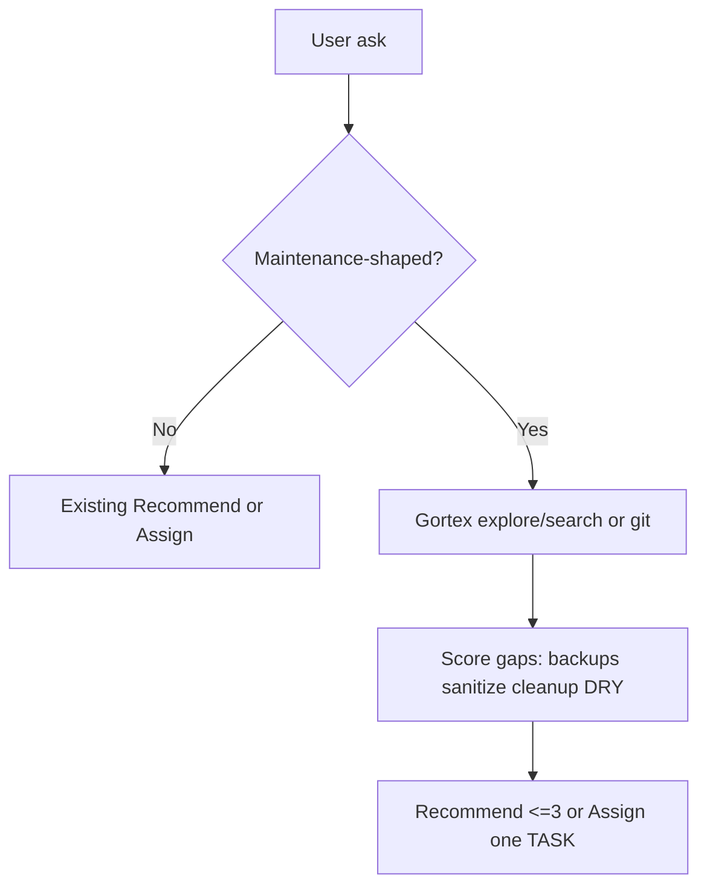

# Spec: Manager maintenance themes

## Objective

Teach the **manager** persona to recommend (or Assign one TASK for) portfolio **maintenance** work in four themes — **backups**, **sanitize**, **cleanup**, **DRY** — when the human asks for that kind of work. The manager still never implements; `/task-loop` and other personas stay unchanged except as needed for a pointer.

Success: on a maintenance-shaped ask, Manager inspects the repo and returns ≤3 grounded recommendations (or one Assign TASK) tied to real paths/commands; on a feature ask, it does not inject these themes.

## Assumptions

1. Scope is **persona guidance** (`.cursor/agents/manager.md` + this spec), not implementing backup/sanitize/cleanup/DRY app changes in the same slice that lands the guidance.
2. Trigger is **option A**: only when the ask is about maintenance, backups, sanitize, cleanup, DRY, or an open “what should I maintain?”
3. Shared orchestration / requirement bar stays in [`.cursor/agents/README.md`](../../.cursor/agents/README.md); this is manager-specific recommend heuristics.
4. Existing surfaces are the seed map (do not invent greenfield systems in recommendations).

## Decisions (locked)

| # | Decision | Choice |
|---|----------|--------|
| D1 | What to change | Manager **recommends** app maintenance themes (not prompt-only DRY/backup of the markdown file itself) |
| D2 | When to surface | **A** — maintenance-shaped asks only |
| D3 | Cap | Recommend ≤3; Assign exactly one TASK yaml when Mode Assign |
| D4 | Grounding | Paths/commands from Gortex/search (or git fallback); skip themes already clearly covered; empty inventing forbidden |

## Out of scope

- Rewriting all personas for DRY
- Changing `/task-loop` flow
- Implementing actual backup/offsite/sanitize/cleanup app work (those become future TASKs Manager emits)
- Extra backup copies of agent markdown (git is backup)

## Tech stack / project structure

- Personas: [`.cursor/agents/manager.md`](../../.cursor/agents/manager.md), shared bar [`.cursor/agents/README.md`](../../.cursor/agents/README.md)
- Spec home: [`docs/specs/`](./) (same pattern as [`platform-hardening.md`](platform-hardening.md))

## Seed map (inspect before recommending)

| Theme | Anchors | What to look for |
|-------|---------|------------------|
| **Backups** | [`scripts/db_maintenance.sh`](../../scripts/db_maintenance.sh), [`docs/operations/backup-restore.md`](../operations/backup-restore.md), `make backup` / `make backup-install`, admin maintenance APIs | Offsite/`BACKUP_REQUIRE_OFFSITE`, restore drill, `LAST_SUCCESS` / stale check gaps vs docs |
| **Sanitize** | [`server/app/core/text.py`](../../server/app/core/text.py), [`client/src/utils/sanitizeEmailHtml.ts`](../../client/src/utils/sanitizeEmailHtml.ts), guest/converter sanitizers, [`docs/reference/security.md`](../reference/security.md) | Unsanitized `v-html`, missing schema validators on new inputs |
| **Cleanup** | fileshare `cleanup_expired` + Celery job, backup rotation, temp/download cleanup (e.g. viddownload) | Expired data left on disk, missing periodic jobs, incomplete rotation |
| **DRY** | Only when search finds duplicated logic | Scoped extract — not speculative “refactor everything” |

## Commands

```bash
# Spec/docs sanity (if docs structure changes)
make docs-build

# No app code required for the guidance slice — no client/server test gate
```

## Code style

Short hard-constraint subsection in `manager.md`. Prefer a pointer to this spec over duplicating long checklists. Recommend/Assign output templates stay unchanged.

## Testing strategy

- Manual: spawn manager (or simulate) with (1) “what should I maintain?” → themes appear, grounded; (2) unrelated feature ask → no forced maintenance item.
- No automated test harness for personas.

## Boundaries

- **Always:** keep manager readonly; ≤3 Recommend; Assign only for implementation asks; ground in found paths; update this spec if the seed map changes
- **Ask first:** expanding trigger beyond A; editing task-loop; adding new deps or app maintenance implementations in the same PR as guidance-only work
- **Never:** spawn personas from manager; invent graph results; recommend work already on `origin/main`; commit secrets

## Success criteria

1. This spec exists with objective, decisions, seed map, boundaries, and success criteria.
2. [`manager.md`](../../.cursor/agents/manager.md) has a trigger-gated maintenance section (A) that does not change Recommend/Assign templates.
3. Feature-shaped asks are explicitly excluded from injecting these themes.
4. Shared README stays the requirement-bar source; manager links here rather than dumping the seed map into README.

## Flow


